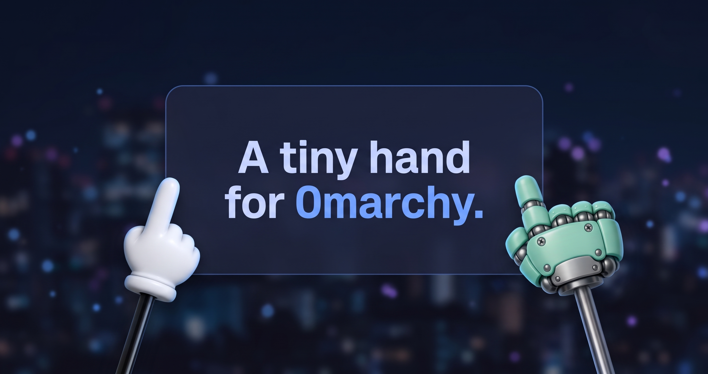
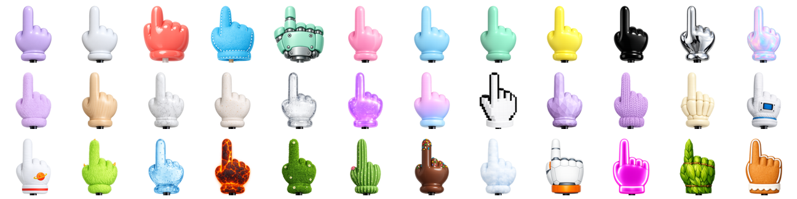

# TinyHand for Omarchy



A tiny hand on a stick that points at things on your screen. Click to tap, drag to draw.

Inspired by and ported from [TinyHand](https://tinyhand.app) by Kamran Ahmed
([nilbuild/tinyhand](https://github.com/nilbuild/tinyhand), macOS, MIT), rebuilt as an Omarchy shell plugin.

- 36 hands and a laser dot, with a toolbar at the bottom of the screen
- Click shows a tap (the window underneath is not clicked), with 15 tap sounds
- Drag to draw, hold `Ctrl` while drawing for an arrowhead
- Hold `Alt` to click for real, double-tap `Shift` to let every click through
- Bar icon: left click toggles, right click opens the menu and settings
- Turns itself off on sleep and screen lock



## Requirements

- Omarchy with the Quickshell-based `omarchy-shell`
- `qt6-multimedia` for tap sounds (Omarchy's own apps already pull it in)
- `gdbus` (from `glib2`) to turn off on sleep and lock. While the pointer is on, the plugin runs
  `gdbus monitor --system --dest org.freedesktop.login1` (read-only, no extra privileges).

## Install

```bash
omarchy plugin add https://github.com/Edoomaan/tinyhand-omarchy --enable
```

If it says `omarchy-shell is not responding`, wait a moment and run `omarchy plugin enable edooman-tinyhand`.

The bar icon lands in the right section. To move it:

```bash
omarchy bar move edooman-tinyhand --section center
```

Then add the shortcuts below to `~/.config/hypr/bindings.lua`. The plugin never edits your config itself.

### Shortcuts

```lua
-- TinyHand
o.bind("CTRL + ALT + H", "Toggle TinyHand pointer", "omarchy-shell shell toggle edooman-tinyhand")
o.bind("CTRL + ALT + X", "Clear TinyHand drawing", "omarchy-shell shell call edooman-tinyhand clear ''")
```

### Click-through keys (optional)

Holding `Alt` and double-tapping `Shift` need Hyprland to report those keys while another app has the keyboard.
These binds are enabled only while the TinyHand overlay is open, so `Alt` and `Shift` work normally otherwise:

```lua
local tinyhand_layers = 0
local tinyhand_binds = {}
local function tinyhand_bind_alive(keybind)
  return keybind ~= nil and tostring(keybind) ~= "HL.Keybind(expired)"
end

hl.on("layer.opened", function(layer)
  if layer.namespace == "edooman-tinyhand-pointer" then
    tinyhand_layers = tinyhand_layers + 1
    if tinyhand_layers == 1 then
      if not tinyhand_bind_alive(tinyhand_binds["alt_up"]) then
        tinyhand_binds["alt_up"] = hl.bind("Alt_L", hl.dsp.exec_cmd("omarchy-shell shell call edooman-tinyhand interactUp ''"), { release = true, transparent = true, ignore_mods = true, non_consuming = true })
      end
      if not tinyhand_bind_alive(tinyhand_binds["shift_down"]) then
        tinyhand_binds["shift_down"] = hl.bind("Shift_L", hl.dsp.exec_cmd("omarchy-shell shell call edooman-tinyhand shiftDown ''"), { transparent = true, ignore_mods = true, non_consuming = true })
      end
      if not tinyhand_bind_alive(tinyhand_binds["shift_up"]) then
        tinyhand_binds["shift_up"] = hl.bind("Shift_L", hl.dsp.exec_cmd("omarchy-shell shell call edooman-tinyhand shiftUp ''"), { release = true, transparent = true, ignore_mods = true, non_consuming = true })
      end
      for _, b in pairs(tinyhand_binds) do
        if tinyhand_bind_alive(b) then b:set_enabled(true) end
      end
    end
  end
end)

hl.on("layer.closed", function(layer)
  if layer.namespace == "edooman-tinyhand-pointer" and tinyhand_layers > 0 then
    tinyhand_layers = tinyhand_layers - 1
    if tinyhand_layers == 0 then
      for _, b in pairs(tinyhand_binds) do
        if tinyhand_bind_alive(b) then b:set_enabled(false) end
      end
    end
  end
end)
```

## Use

| | |
|---|---|
| `CTRL + ALT + H` or the bar icon | Turn the pointer on or off |
| Right-click the bar icon | Menu and settings |
| Click | Tap (nothing underneath gets clicked) |
| Hold and drag | Draw on the screen |
| Hold `Ctrl` while drawing | Add an arrowhead |
| Hold `Alt` | Click for real |
| Double-tap `Shift` | Let every click through until you double-tap again |
| `CTRL + ALT + X` | Clear the drawing |
| `Esc` | Clear everything and turn the pointer off |

Scripts can drive it too:

```bash
omarchy-shell shell call edooman-tinyhand <on|off|toggle|clear> ''
omarchy-shell shell call edooman-tinyhand style <hand-id|laser>
omarchy-shell shell call edooman-tinyhand sound <on|off|toggle>
```

Settings are stored in `~/.local/state/edooman-tinyhand/settings.json`.

## Remove

```bash
omarchy plugin remove edooman-tinyhand
rm -rf ~/.local/state/edooman-tinyhand
```

Then delete the TinyHand lines you added to `~/.config/hypr/bindings.lua`.

## Development

```bash
node --test tests/                     # unit tests for the pure JS logic
omarchy plugin validate .
omarchy plugin update edooman-tinyhand # after committing
omarchy restart shell                  # keepLoaded overlays need a restart to pick up QML changes
```

`dev/` holds a nested Hyprland harness for testing input without touching your session.

Built following the Omarchy [plugin development guide](https://plugins.omarchy.org/develop.html)
and [publishing guide](https://plugins.omarchy.org/publish.html).

## Credits

TinyHand for Omarchy is inspired by [TinyHand](https://github.com/nilbuild/tinyhand) by Kamran Ahmed.
The behavior, timings, hand images and tap sounds come from the original; the Omarchy shell plugin
(Quickshell/QML, Wayland input, Hyprland binds) is a rewrite.

## License

MIT. See [LICENSE](LICENSE).
